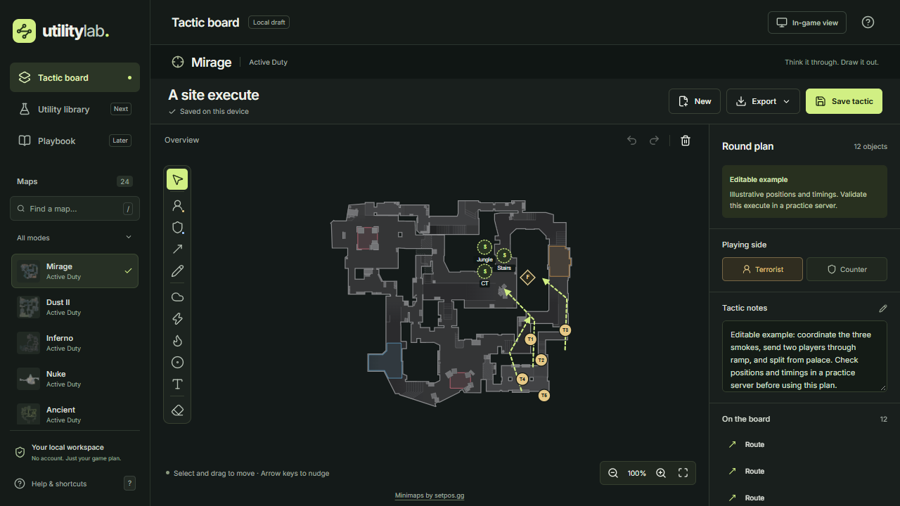

# Utility Lab

Local-first Counter-Strike 2 tactics, utility lineups, and a team playbook.

The first draft is the **tactic board**: 24 current map variants, 49 map/floor/arena views, a drawing workspace, local saving, and tactic import/export. The utility library and playbook are later stages.



```sh
cd utility-lab
npm ci
npm run dev
```

See [application instructions](utility-lab/README.md), [product scope](PRODUCT.md), [design direction](DESIGN.md), and [map artwork sources](utility-lab/docs/map-sources.md).

All data stays in the browser unless exported. The initial draft is served locally; repository publication does not deploy the website.
