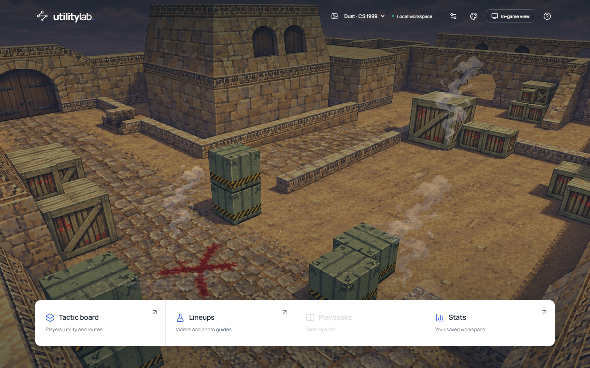

# Utility Lab

Public website: **[utilitylab.au](https://utilitylab.au)**, hosted on Cloudflare Pages. Local development remains available at **http://127.0.0.1:5180**.

A local-first Counter-Strike 2 workspace for tactic boards, map-based photo and video lineups, five-player round rehearsal and local statistics.

## Start the local release

Install Node.js **22.13 or newer**, then run from this folder in PowerShell:

```powershell
.\Start-UtilityLab.ps1
```

The launcher installs dependencies if needed, builds the app and serves it at **http://127.0.0.1:5180**. Keep the terminal open; press **Ctrl+C** to stop. The first dependency installation needs internet access.

For manual setup:

```sh
cd utility-lab
npm ci
npm run build
npm start
```

Public releases use a verified filtered static artifact uploaded to Cloudflare Pages. The complete application source is maintained in the [public repository](https://github.com/Minhhh13/utility-lab); a Git push and a Cloudflare deployment are separate release steps. Current hosting checks and limitations are recorded in the [verification record](utility-lab/docs/verification.md).

## Included

- Eight maps and 10 floor views, with a full-canvas tactic editor, recoverable drafts, named tactics and JSON/PNG transfer. Smooth freehand strokes form one undo action each; text is edited directly on the board. Pen and arrow colours are selectable, and arrowheads follow their shaft colour.
- **1,558 published lineups from 1,478 source pages** are available on eight maps. Choose a utility, destination and starting spot directly on the map. The chooser connects each recipe to its actual standing point and paginates groups of more than eight. Selections preserve your zoom and pan on the same floor.
- Each published lineup has four labelled steps covering where to stand, the first-person starting view, where to aim and the landing. Arrow keys, swipes, zoom and pan work inside the viewer. The aim crosshair has adjustable colour, size and shape. Credited source footage is available from the guide.
- The viewer's Save star and ellipsis menu preserve favorites, Copy lineup link, Download lineup and Make my own. Personal guides also expose Edit personal lineup and Delete your lineup; saving an edit reopens its viewer.
- The T/CT switch sits beside the utility filters on the left. The map chooser fades its scrollable edges. Wheel and trackpad users can zoom a photo around the pointer from 100% to 400%.
- A small **Suggest lineup** action stores up to 50 suggestions locally and exports JSON. It does not submit to a backend. Personal records and uploaded media retain their portable files and direct links.
- **Playbooks** assigns five players roles and timed cues. Open **Add Mirage example** to rehearse a complete round, scrub the radar and open a cue sheet for each player. Export and import a playbook to transfer its linked resources.
- Filtered local statistics, four accent palettes, Light/Dark/System appearance, workspace backups and an all-maps offline action.
- A compact **Display settings** menu groups In-game view, persistent **Auto / 16:9 / 4:3** desktop frames and **Hide top bar**. A floating 44px **Show top bar** control restores the header. Narrow phones fit automatically; map geometry and editing state stay intact. Home stays full-screen; the saved ratio applies to the working tabs.
- A responsive web app and a prepared Capacitor iOS project. The native project has not been compiled or signed.
- Three pixel recreations of Dust from original CS, Source and early CS:GO, selected through the top bar, with rising lane smoke, windblown sand, drifting dust and short workspace fades. A restored route symbol is shared across the app and installation icons.

Your browser keeps the workspace. The public site, `127.0.0.1:5180`, `localhost:5180` and development each have separate storage. To transfer local work to the public site, use **Workspace settings → Export workspace** at the old URL, then **Import backup** at the new URL. Keep a backup before clearing browser data. Uploaded photos are included in portable exports. The offline photo pack includes the app’s bundled guide and archive images; original source-hosted galleries and videos require internet. Photos and clips load only when requested, and map catalogues load one at a time. See the [current source and coverage inventory](utility-lab/docs/expanded-catalogue.md).

The eight Compendium guides show three source-panel views plus the full original composite. These views preserve original floor boxes and annotations; they are not additional captures. The 223 older creator-video records remain available through existing deep links, outside the primary photo-map catalogue.

All 1,504 published entries have source-backed target-area pins. Publisher destination coordinates are registered to the displayed artwork, with explicit floor reviews. Original media decoding and browser playback have been checked; the sources are not independent validation of throws on the current game build. Actual Steam-overlay and physical iPhone behavior remain unverified.

This update uses online sources and project files only. Utility Lab does not launch CS2, access its installation or interact with gameplay.



See the [application guide](utility-lab/README.md), [local release instructions](utility-lab/docs/local-release.md), [product scope](PRODUCT.md), [design system](DESIGN.md), [creator sources](utility-lab/docs/lineup-sources.md) and [verification record](utility-lab/docs/verification.md).

The custom domain is verified with HTTPS. The former [pages.dev address](https://utility-lab-8b0.pages.dev) remains available for workspace exports; [domain setup and backup transfer](utility-lab/docs/custom-domain.md).
