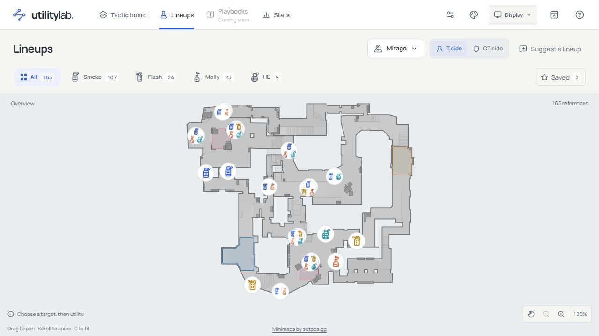
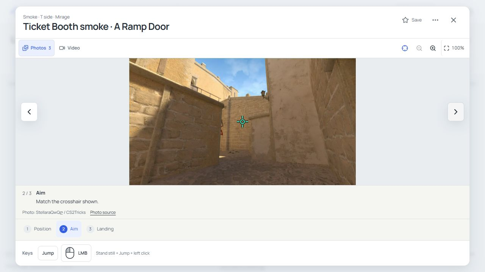

# Lineups verification — corrected published baseline

Verified on 15 November 2026. This supersedes the earlier verification of changes
based only on the older `main` source.

## Data and source preservation

The active application now uses the owner's published Cloudflare baseline, rather
than the smaller library in `main` at `a26b2c8`. Its original TypeScript source was
unavailable; the public JS/CSS snapshot and an adapter are checked in with
[provenance and regeneration instructions](../tools/published-snapshot/README.md).

All eight catalogue JSON files remain byte-identical: Ancient 165, Anubis 282,
Cache 118, Dust II 202, Inferno 206, Mirage 234, Nuke 183 and Vertigo 110 —
**1,500 total**. All eight standing-position JSONs and all **418 local photos**
retain their original bytes. External media URLs remain unchanged. No personal
browser records were extracted or inserted.

The adapter retains application bindings and side effects while replacing bundled
framework factories with the repo's React/React DOM/Lucide dependencies. It imports
paired CSS and lets Vite produce fresh chunks. Requested presentation changes are
isolated in `lineups-layout.css`, two reordered zoom-control arrays and one small
photo-wheel hook calling the original camera function. Previous replacements of
the old map/photo viewer and changes to map bounds have been removed.

## Checks passed

- TypeScript and production build.
- **22 unit tests**, including exact SHA-256 checks for the 1,500 records and 475
  published public assets (16 JSON files plus 459 media/shell/map assets).
- `node tools/published-snapshot/restore.mjs --check`: all 31 generated modules
  reproduce from the pinned archive and the explicit presentation transforms.
- Direct browser checks against a local production preview without an asset proxy.
  The final entry loaded `index-KIIfwJuN.js`.

The older model/media tests still pass, but do not alone prove the recovered UI.
The separate historical Playwright suite was not run. The browser checks below
are direct UI observations.

## Browser observations

| Flow | Result |
| --- | --- |
| Library counts | Mirage T shows All 165, Smoke 107, Flash 24, Molly 25, HE 9. |
| Original chooser | Ticket Booth → Smoke → A Ramp Door opens the original three-photo guide, attribution, keys and video option. |
| Original aim annotations | Aim slide loads its original image and crosshair; Position/Aim/Landing controls remain. |
| Map wheel | Wheel input changes 100% to 157%; fit restores 100%. |
| Map pan | Original hand tool pans the SVG viewBox without opening a lineup. |
| Map/photo controls | Minus and plus are adjacent in DOM and visual order; original handlers and fit button remain. |
| Photo wheel | Wheel changes 100% to 294%, while page scroll stays at 0. The original 100–400% limits apply. |
| Photo buttons and slides | Plus changes 100% to 150%; switching to the Aim slide resets to 100% and keeps its annotation. |
| Small screens | At 390×843 and 320×800, all photo zoom controls remain inside the viewport, with no page overflow. Desktop map overrides do not apply below 861px. |
| Tactic board | Original board opens with 12 starter objects; placing smoke produces 13; Undo restores 12. |
| Navigation | Lineups, Tactic board and Stats load; Playbooks retains Coming soon. |

At the default 1280×720 viewport, the Lineups SVG height increased from about
382.9px in the published layout to **442px**, approximately **15.4%**. Map geometry
and catalogue coordinates are unchanged.

## Limits

The published JS/CSS snapshot is a temporary maintenance compromise, not the
original authored source. When that source is available, port only the small
presentation changes to it. Third-party playback availability, physical touch
gestures, Safari/WebKit and the actual Steam overlay require separate testing.
No grenade throw was validated in CS2. The Cloudflare site has not been deployed
or changed by this branch work.
