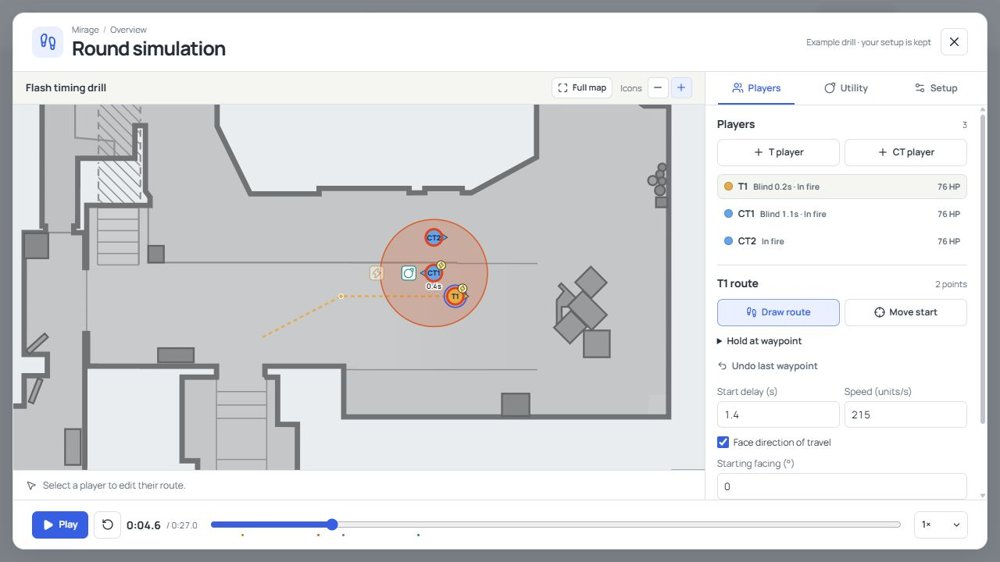

# Tập phối hợp utility trên Tactic board

Chọn một tình huống cụ thể để tập, chẳng hạn người thứ nhất ném flash qua góc, người thứ hai quay lại peek ngay sau tiếng nổ. Trên radar, điều cần so sánh là lúc flash nổ, hướng nhìn của mỗi người tại thời điểm đó và lúc người đi đầu tới góc.

## Dựng tình huống

1. Trong Tactic board, chọn đúng map và tầng. Đặt T, CT ở vị trí bắt đầu, đặt utility ở điểm dự kiến phát huy tác dụng.
2. Bấm **Simulate → Players**. Một mũi tên có điểm đầu gần người chơi có thể được dùng làm đường đi ban đầu. Chọn từng người rồi dùng **Draw route**, bấm các điểm rẽ trên radar theo thứ tự, kết thúc bằng **Done**. Chỉnh **Start delay (s)** để hai người ra góc lệch nhịp. Với người giữ góc hoặc đi ngang để kê tâm, tắt **Face direction of travel** rồi đặt hướng nhìn.
3. Trong **Utility**, chọn loại lựu đạn và đặt **Detonate at (s)** tính từ đầu kịch bản. Mốc này là lúc smoke bung, flash nổ hoặc lửa bắt đầu cháy. Với một lineup đã tập, lấy thời gian bay từ bản ghi đúng cú ném. Trong **Setup → Draw cover**, bấm hai đầu đoạn tường sẽ che người chơi tại góc đó.
4. Bấm **Play**, dừng khi người đi đầu qua góc và kiểm tra trạng thái blind hoặc mất máu. Tua lại cùng mốc, thay đổi một yếu tố như thời điểm bật flash rồi so sánh. Khi icon sát nhau, giảm kích thước bằng bộ nút chỉnh icon trên radar để nhìn rõ đội hình.

Trong **Utility**, có thể gán người ném và thời gian bay. Ví dụ đặt mốc nổ ở giây 3 và thời gian bay 0,8 giây thì lựu đạn rời vị trí của người ném tại giây 2,2. Nếu người ném đã bị hạ trước mốc thả, cú ném bị hủy. Ký hiệu bay đi theo đoạn thẳng nhìn từ trên xuống. Độ cao, các lần chạm tường và thời điểm nảy phải lấy từ cú ném thật để căn nhịp.

Trong **Setup**, chọn **Try a flash drill** để mở bài mẫu. Tại giây 1, CT nhìn về flash bị blind khoảng 4,7 giây, CT quay đi bị khoảng 1,2 giây. Molotov xuất hiện ở giây 4, smoke cùng vị trí dập lửa ở giây 5, HE mở khói ở giây 8. Bấm **Back to my setup** để quay về bài đang soạn. Dùng **Export rehearsal** để gửi bài cho bạn chơi cùng. Người nhận mở đúng map và tầng rồi chọn **Import rehearsal**.

## Các mốc dùng để đối chiếu

Khi mở từ một board chưa có bài tập đã lưu, các marker utility lấy mốc kích hoạt mặc định là giây 0. Hãy chỉnh **Detonate at (s)** cho từng quả trước khi so thời gian. Mũi tên ở gần một người có thể được gán làm đường chạy ban đầu; kiểm tra lại đúng người và dùng **Hold at waypoint** nếu cần chờ flash ở một góc. Trên map khác, bài flash mẫu chỉ minh họa cơ chế; hãy đặt lại vị trí để tập một góc thực tế.

| Cơ chế | Dữ liệu tham chiếu của CS2 | Ý nghĩa khi tập |
| --- | --- | --- |
| Chạy trên nền phẳng | Tốc độ tối đa với AK-47 là 215, với M4 là 225, với dao là 250 đơn vị game mỗi giây. Đi bộ khoảng 52%, ngồi đi khoảng 34% tốc độ của vũ khí đang cầm. [Dữ liệu vũ khí](https://github.com/SteamTracking/GameTracking-CS2/blob/82e2b9d62cc97f1358c68a220a4a392c9e41c509/game/csgo/pak01_dir/scripts/weapons.vdata) · [Phép đo chuyển động](https://docs.pureskill.gg/datascience/adx/cs2/csds/enums/#movement-speed) | Trên Mirage, đoạn 100 đơn vị board tương đương khoảng 512 đơn vị game theo radar chuẩn. Chạy thẳng ở 215 đơn vị/giây mất khoảng 2,38 giây. Đo từ lúc người chơi đã đạt vận tốc ổn định khi so với demo. |
| Smoke | PureSkill đo được 22,06 giây từ sự kiện bung tới sự kiện hết smoke. Mốc hết hiệu lực được ghi trong demo và thời điểm một góc bắn bắt đầu nhìn xuyên được có thể khác nhau. [Số đo từ 50 trận tháng 9–10/2026](https://docs.pureskill.gg/datascience/adx/cs2/csds/enums/#bomb-and-utility) | Căn khoảng trống giữa hai smoke bằng đồng hồ. Với một góc peek sát mép smoke, thử thêm trong game. |
| Flash | Demo ghi thời gian blind riêng cho từng người. Tập dữ liệu trên ghi nhận tới 5,3 giây. [Sự kiện player_blind của game](https://github.com/SteamTracking/GameTracking-CS2/blob/82e2b9d62cc97f1358c68a220a4a392c9e41c509/game/csgo/pak01_dir/resource/mod.gameevents) · [Kết quả đo](https://docs.pureskill.gg/datascience/adx/cs2/csds/enums/#bomb-and-utility) | So sánh người nhìn thẳng về điểm nổ với đồng đội quay mặt đi tại cùng một thời điểm. Thời gian blind trên board là ước lượng theo bố trí 2D. |
| Lửa | CS2 cấu hình thời gian sống trung bình mỗi ngọn lửa là 7 giây cho Molotov, 5,5 giây cho incendiary. Tầm lan tối đa tương ứng là 150 và 110 đơn vị. Mức sát thương cơ sở là 40 HP/giây, chu kỳ tính sát thương 0,2 giây. [Convar máy chủ, bản trích ngày 11/11/2026](https://github.com/SteamTracking/GameTracking-CS2/blob/82e2b9d62cc97f1358c68a220a4a392c9e41c509/DumpSource2/convars.txt) | Chọn đúng loại lửa. Ghi thời điểm người chơi vào và ra vùng cháy. Trong game các ngọn lửa lan lần lượt theo bề mặt. |
| HE | Dữ liệu vũ khí ghi sát thương cơ sở 99 và tầm 350 đơn vị. Valve cũng minh họa vụ nổ mở một khoảng trống tạm thời trong khói. [Dữ liệu HE](https://github.com/SteamTracking/GameTracking-CS2/blob/82e2b9d62cc97f1358c68a220a4a392c9e41c509/game/csgo/pak01_dir/scripts/weapons.vdata) · [Valve, Responsive Smokes](https://www.youtube.com/watch?v=_y9MpNcAitQ) | Dùng HP trên board để so hai cách bố trí. Kết quả một cú ném trong game còn phụ thuộc vật cản, độ cao và giáp. |

Mặc định, board cho smoke tồn tại 22 giây, Molotov 7 giây, incendiary 5,5 giây và flash có thể gây blind tới 5,3 giây. Vùng smoke dùng bán kính 144 đơn vị game. Mô hình flash giảm mức blind theo khoảng cách và góc nhìn trong phạm vi 1.500 đơn vị. Khoảng mở do HE có bán kính tới 160 đơn vị và khép lại sau 1,5 giây. Các bán kính khói, flash, khoảng mở và đường suy giảm là giả định của trình mô phỏng.

## Tỉ lệ radar và góc khuất

Tỉ lệ của ảnh overview chuẩn khác nhau giữa các map. Ví dụ Mirage dùng hệ số 5, Nuke dùng 7. Với radar gốc 1024 và board chuẩn hóa về 1000, một đơn vị board tương ứng `scale × 1024 / 1000` đơn vị game. Ảnh radar tự nhập có thể đã cắt mép hoặc co giãn. Đo khoảng cách giữa hai mốc trong game, chia cho khoảng cách giữa cùng hai mốc trên radar rồi nhập kết quả vào **Setup → World units per radar unit**. Chọn hai mốc cách xa nhau trên mặt phẳng để giảm sai số. [Tệp overview của Mirage](https://github.com/SteamTracking/GameTracking-CS2/blob/82e2b9d62cc97f1358c68a220a4a392c9e41c509/game/csgo/pak01_dir/resource/overviews/de_mirage.txt) · [Bảng overview các map](https://cs2opendev.github.io/CS2OpenDev-Docs/maps/)

Một ảnh radar thể hiện mặt bằng của tầng. Cửa di động, độ cao của hộp, vị trí mắt khi cúi, đường ném vòng qua tường và khói tràn qua cửa sổ đều có thể thay đổi kết quả trong CS2. Đối chiếu những tình huống này bằng demo hoặc phòng tập. Nếu cần kiểm tra tự động theo địa hình, Awpy cung cấp lưới đường đi và lưới va chạm tĩnh ứng với từng phiên bản game. Phép kiểm tra tia nhìn cần hai điểm trong không gian 3D, trong đó điểm của người chơi đặt ở độ cao mắt. [Awpy, dữ liệu địa hình và tầm nhìn](https://awpy.readthedocs.io/en/stable/visibility.html)

Trong trình mô phỏng, **Draw cover** đặt một đoạn tường theo tầng đang mở. Người chơi đi tới đoạn tường sẽ dừng tại đó. Muốn chạy vòng qua, thêm các điểm rẽ hai bên cửa. Tường tự đánh dấu cũng chắn hiệu ứng flash, sát thương HE và tác động của HE lên smoke ở phía bên kia. Bản cập nhật ngày 30/3/2023 của Valve ghi nhận cơ chế chắn tương tác HE–smoke của tường. [Valve, Release Notes](https://steamcommunity.com/games/CSGO/announcements/detail/6385581887740781734)

## Hiệu chỉnh bằng một round thật

Trong phòng tập, dùng cùng map, cùng tầng, cùng vũ khí và cùng vị trí bắt đầu. Ghi một lượt chạy có một smoke, một flash và một lần qua góc. Lấy thời điểm bắt đầu chạy làm giây 0. Đối chiếu thời gian tới góc, giây smoke bung, giây flash nổ và thời gian từng người bị blind. Chỉnh đường và thời điểm của tactic theo chênh lệch vừa đo.

Nếu phân tích file demo, các bảng `smokes`, `fires` và `blinds` của Awpy cho biết khoảng hiệu lực và nạn nhân của từng flash. Dùng tick rate ghi trong demo để đổi chênh lệch tick sang giây. Với smoke/lửa, chọn một lượt mà hiệu ứng kết thúc trước lúc reset round để có mốc hết hiệu lực đầy đủ. [Awpy, dữ liệu grenade và blind](https://awpy.readthedocs.io/en/latest/datasets.html)
